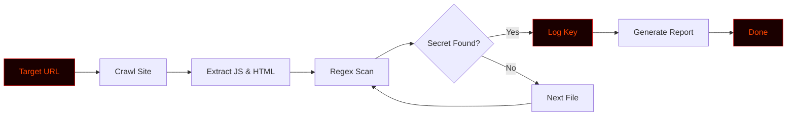

# KeyHunter


# 🔑 KEYHUNTER


<div align="center">

**A Python-based API Key and Secret Hunter for bug bounty hunters and red teamers.**

[](https://github.com/anonmoty/KeyHunter)
[](https://python.org)
[](LICENSE)
[](https://github.com/anonmoty/KeyHunter)

</div>

---

## ⚠️ Legal Disclaimer

```
╔══════════════════════════════════════════════════════════════════════╗
║                                                                      ║
║   KEYHUNTER is an OFFENSIVE security tool built for AUTHORIZED       ║
║   penetration testing, red teaming, and bug bounty programs only.    ║
║                                                                      ║
║   ▸ Use ONLY on domains you own or have written permission to test.  ║
║   ▸ Unauthorized data extraction or exploitation is ILLEGAL.         ║
║   ▸ Always follow the bug bounty scope and local laws.               ║
║   ▸ The author is NOT responsible for any misuse or damage.          ║
║                                                                      ║
║   Hack responsibly. Hunt ethically. Report professionally.           ║
║                                                                      ║
╚══════════════════════════════════════════════════════════════════════╝
```

---

## 🎯 Overview

**KeyHunter** is a Python-based **secret scanning tool** designed to automatically crawl web applications and extract exposed API keys, tokens, and sensitive credentials. It is built for bug bounty hunters and red teamers who want to automate the discovery of leaked secrets in JavaScript files and HTML source code.

Whether you're hunting for AWS keys or leaked Stripe tokens — KeyHunter gives you the edge to find them before anyone else.

---

## ✨ Core Features

```
┌─────────────────────────────────────────────────────────────────────┐
│  [01] 🕷️ Deep Crawler         → Maps the target web application       │
│  [02] 🔍 JS Analyzer          → Extracts secrets from JS files       │
│  [03] 🎯 Regex Engine         → 50+ patterns for API keys/tokens     │
│  [04] ☁️ Cloud Providers      → AWS, GCP, Azure, Stripe, GitHub      │
│  [05] 📡 Custom Headers       → Bypass basic protections             │
│  [06] ⚡ Multi-Threaded       → Fast parallel scanning               │
│  [07] 📊 Live Progress Bar    → Real-time terminal feedback          │
│  [08] 📝 JSON Reports         → Structured findings for reports      │
│  [09] 🎨 Hacker Terminal UI   → Red + Black aesthetic                │
└─────────────────────────────────────────────────────────────────────┘
```

---

## 🚀 Installation

```bash
# 1. Clone the repo
git clone https://github.com/anonmoty/KeyHunter.git
cd KeyHunter

# 2. Install dependencies
pip install -r requirements.txt

# 3. Run the tool
python keyhunter.py --help
```

**One-liner (copy-paste):**

```bash
git clone https://github.com/anonmoty/KeyHunter.git && cd KeyHunter && pip install -r requirements.txt && python keyhunter.py --help
```

---

## 🎯 Usage

```bash
# Scan a single domain
python keyhunter.py -u https://target.com

# Deep scan with multi-threading
python keyhunter.py -u https://target.com --threads 20

# Scan a list of URLs
python keyhunter.py -l urls.txt --output reports/keys.json
```

### CLI Flags

| Flag | Description |
|:---|:---|
| `-u, --url` | Target URL to scan |
| `-l, --list` | File containing list of URLs |
| `--threads` | Number of concurrent threads (default: 10) |
| `--output` | Save results to JSON |
| `--verbose` | Enable verbose logging |
| `--help` | Show help menu |

---

## 🧠 How It Works



1. **Crawl** — Gathers all reachable pages and JS files.
2. **Extract** — Parses raw code for hidden strings.
3. **Scan** — Matches against 50+ secret patterns.
4. **Report** — Outputs found keys and their locations.

---

## 📁 Project Structure

```
KeyHunter/
├── keyhunter.py
├── core/
│   ├── crawler.py
│   ├── parser.py
│   ├── scanner.py
│   └── reporter.py
├── patterns/
│   └── secrets.json
├── reports/
├── tests/
├── requirements.txt
├── LICENSE
└── README.md
```

---

## 📸 Demo

```
██████████████████████████████████████████████████████████████████████
█                                                                    █
█   KEYHUNTER v1.0.0                                                 █
█   ───────────────────────────────────────────────────────────      █
█                                                                    █
█   [✓] Target: https://target.com                                   █
█   [✓] Threads: 20                                                  █
█   [→] Crawling JS files...                                         █
█                                                                    █
█   [████████████████████████░░░░░░] 80%                             █
█                                                                    █
█   [!] FOUND: AWS Access Key → /js/main.js                          █
█   [!] FOUND: Stripe Secret  → /js/payment.js                       █
█   [✓] Scan complete in 5.12s                                       █
█   [✓] Report: reports/keys_2024.json                               █
█                                                                    █
█                    Secrets Exposed! 🔑                             █
█                                                                    █
██████████████████████████████████████████████████████████████████████
```

---

## 🛠️ Requirements

```txt
requests>=2.28.0
aiohttp>=3.9.0
beautifulsoup4>=4.11.0
colorama>=0.4.6
tqdm>=4.65.0
rich>=13.0.0
```

```bash
pip install -r requirements.txt
```

---

## 🎨 Terminal Theme

KeyHunter uses a **red + black** hacker palette:

```python
THEME = {
    "primary":   "\033[38;5;196m",  # Bright Red
    "secondary": "\033[38;5;202m",  # Dark Red
    "accent":    "\033[38;5;214m",  # Amber
    "error":     "\033[38;5;196m",  # Red
    "warning":   "\033[38;5;220m",  # Yellow
    "info":      "\033[38;5;51m",   # Cyan
    "reset":     "\033[0m",
}
```

---

## 🐛 Bug Bounty Workflow

```
██████████████████████████████████████████████████████████████████████
█                                                                    █
█   [01] Subdomain Recon      →  subfinder, amass                    █
█   [02] Live Host Detection  →  httpx                               █
█   [03] Secret Hunting       →  KEYHUNTER  ← you are here           █
█   [04] Validation           →  Test leaked keys                    █
█   [05] Reporting            →  Submit to HackerOne/Bugcrowd        █
█                                                                    █
██████████████████████████████████████████████████████████████████████
```

---

## 🗺️ Roadmap

```
┌─────────────────────────────────────────────────────────────────────┐
│  [x] Deep web crawler                                               │
│  [x] JavaScript parser                                              │
│  [x] 50+ API key regexes                                            │
│  [x] JSON reports                                                   │
│  [x] Hacker terminal UI                                             │
│  [ ] Source map analysis                                            │
│  [ ] Git history scanning                                           │
│  [ ] Docker image                                                   │
│  [ ] Web dashboard                                                  │
└─────────────────────────────────────────────────────────────────────┘
```

---

## 🤝 Contributing

1. Fork the repo
2. Create branch (`git checkout -b feature/amazing`)
3. Commit (`git commit -m 'Add amazing feature'`)
4. Push (`git push origin feature/amazing`)
5. Open Pull Request

---

## 📜 License

MIT License. See [`LICENSE`](LICENSE).

---

## 🙏 Credits

- **Author:** [@anonmoty](https://github.com/anonmoty)
- **Inspired by:** The bug bounty community
- **Built with:** Python, caffeine, and curiosity ☕

---

<div align="center">

```
██████████████████████████████████████████████████████████████████████
█                                                                    █
█        🔑  HUNT HARD.  EXTRACT SMART.  REPORT RESPONSIBLY.  🔑     █
█                                                                    █
█                  ⭐  If this tool helped you, star it!  ⭐           █
█                                                                    █
██████████████████████████████████████████████████████████████████████
```

</div>
